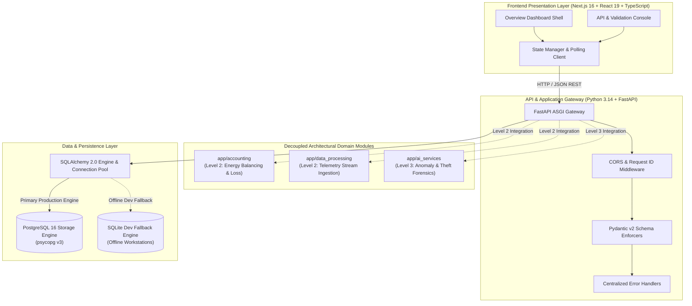

# GRIDGUARD NEXUS X — ARCHITECTURE SPECIFICATION
**Platform**: Software-Only Electricity Intelligence and Investigation Platform  
**Milestone**: Level 1: Project Foundation  

---

## 1. System Overview

GridGuard Nexus X is an enterprise software platform designed to ingest grid telemetry, execute deterministic energy accounting, detect non-technical losses (electricity theft and meter anomalies), and generate defensible forensic audit dossiers.



---

## 2. Decoupled Architectural Boundaries

To preserve architectural integrity across progressive levels of development, code is segregated into strict boundaries:

| Directory | Layer / Purpose | Level Active | Restrictions Observed |
| :--- | :--- | :--- | :--- |
| `frontend/` | Next.js SPA, Tailwind CSS, TypeScript UI | **Level 1** | No fabricated statistics; clean shells and real diagnostics. |
| `backend/app/api/` | FastAPI routers, endpoints, versioning | **Level 1** | Strict request/response envelope wrapping. |
| `backend/app/core/` | Global error handlers, custom exceptions | **Level 1** | 100% consistent error format across status codes. |
| `backend/app/schemas/`| Pydantic v2 validation models | **Level 1** | Boundary checking, data typing, regex sanitization. |
| `backend/app/database/`| SQLAlchemy 2.0 engine & session lifecycle | **Level 1** | Non-blocking health checks, connection pooling. |
| `backend/app/accounting/`| Energy accounting & feeder balancing | **Level 2** | Boundary guarded; no logic executed in Level 1. |
| `backend/app/data_processing/`| High-throughput stream normalization | **Level 2** | Boundary guarded; no logic executed in Level 1. |
| `backend/app/ai_services/`| Forensic investigation & theft detection | **Level 3** | Boundary guarded; no logic executed in Level 1. |
| `database/` | PostgreSQL initialization scripts & schema | **Level 1** | Extension provisioning & diagnostics audit tables. |
| `tests/` | Pytest and Vitest test suites | **Level 1** | Automated test verification on every commit. |

---

## 3. Communication Contract

All communications between the frontend and backend strictly adhere to standard JSON envelopes:

### Success Response Envelope:
```json
{
  "status": "success",
  "data": { ... },
  "meta": {
    "version": "1.0.0-level1",
    "timestamp": "2026-10-29T15:00:00Z",
    "request_id": "a93bf81d-e2d4-4c28-9ec1-192b0c159a43"
  }
}
```

### Error Response Envelope:
```json
{
  "status": "error",
  "error": {
    "code": "ERR_VALIDATION_FAILED",
    "message": "Validation failed for field 'grid_frequency_hz'",
    "field": "grid_frequency_hz",
    "details": [ ... ]
  },
  "meta": {
    "version": "1.0.0-level1",
    "timestamp": "2026-10-29T15:00:00Z",
    "request_id": "a93bf81d-e2d4-4c28-9ec1-192b0c159a43"
  }
}
```
